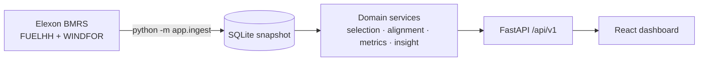

# GB Wind Forecast Monitor

How accurate is the national wind forecast that a GB energy trader can actually see **before** the
day-ahead auction closes, and how much wind should they *not* count on? This app back-tests the Elexon
WINDFOR forecast against FUELHH outturn for decisions made in January 2026. It turns the error into
a buffer recommendation for purchasing.

**Live app:** _not deployed yet. Run `vercel --prod` (see [Deploy](#deploy)) and paste the URL here._


<details><summary>Dark mode</summary>


</details>

## Key findings (January 2026, D-1 09:20 cutoff)

| | |
|---|---|
| Mean absolute error | **2,039 MW** (RMSE 2,505 MW, MAPE 22 %) |
| Bias | **+1,748 MW**: forecasts ran high; wind fell short in **85 %** of hours |
| P90 shortfall | 4,377 MW |
| Buffer for 90 % cover | **4,098 MW** (= 1,748 MW persistent offset + 2,350 MW random) |
| Out-of-sample | buffer sized on 2–16 Jan covered **90.6 %** of hours on 17 Jan – 1 Feb |

About 1.5 GW of the bias is a **systematic offset between WINDFOR and FUELHH**. It persists even in WINDFOR's values for
hours that had already ended. Elexon's docs don't explain it, so the dashboard flags it as a caveat
rather than presenting it as forecasting error. Full write-up: [docs/analysis.md](docs/analysis.md).

## Quick start

### Docker (everything in one container)
```bash
docker compose up --build        # http://localhost:8000  (API docs: /api/v1/docs)
docker compose run --rm ingest --from 2026-01-02 --to 2026-02-01   # optional: re-fetch from Elexon
```
The image ships with the January snapshot, so it works offline.

### Local development
Requires [uv](https://docs.astral.sh/uv/) (it installs Python 3.12 itself) and Node 22.
```bash
make install        # uv sync + npm ci
make dev            # API on :8000 (reload) + Vite on :5173 (proxies /api)
make ingest FROM=2026-01-02 TO=2026-02-01
make test           # pytest + vitest
make lint           # ruff, mypy --strict, eslint, prettier, tsc
uvx pre-commit install   # run the same checks on every commit (from the repo root)
```
No `make` (e.g. Windows)? Each target is a one-liner in the [Makefile](Makefile), for example
`cd backend && uv run uvicorn app.main:app --reload` and `cd frontend && npm run dev`.

Configuration is via `APP_*` environment variables; see [.env.example](.env.example). Nothing is secret.
The optional `APP_REFRESH_TOKEN` enables `POST /api/v1/admin/refresh` on writable hosts.

## API

OpenAPI: `/api/v1/openapi.json`, interactive docs at `/api/v1/docs`. Common query parameters:
`from`, `to` (delivery days), `mode=cutoff|horizon`, `cutoff_time=HH:MM` (default 09:20),
`horizon_h` (0–72).

| Endpoint | Purpose |
|---|---|
| `GET /api/v1/health` | status + snapshot extent + last ingest |
| `GET /api/v1/meta` | data range, cutoff presets, defaults |
| `GET /api/v1/forecast-vs-actual` | hourly rows (actual, selected forecast, publish time, lead time); `format=csv` |
| `GET /api/v1/metrics` | MAE, RMSE, bias, MAPE, percentiles, shortfall/surplus split, buffer insight, coverage |
| `GET /api/v1/metrics/by-horizon` | metrics per lead time (`horizons=1,4,12,24`) + the cutoff reference point |
| `GET /api/v1/metrics/by-hour` / `by-day` | breakdowns by London hour / delivery day |
| `GET /api/v1/error-distribution` | histogram (`bin_mw`) + quantiles |
| `GET /api/v1/diagnostics/bias` | tests for whether the bias is forecast error or an offset |
| `POST /api/v1/admin/refresh` | re-ingest (token-protected; disabled on read-only deploys) |

Errors are [RFC 9457](https://www.rfc-editor.org/rfc/rfc9457) `application/problem+json` (400, 404, 422, 502, 503).

## Architecture


Details: [docs/architecture.md](docs/architecture.md). Decisions: [docs/adr/](docs/adr).

## Repository layout

| Path | What it is |
|---|---|
| `backend/app/core/` | `config.py` settings, `logging.py`, `timeutils.py` (London days, DST-safe cutoffs) |
| `backend/app/models/` | `records.py` Elexon wire + domain records; `api.py` response schemas |
| `backend/app/clients/elexon.py` | async httpx client: chunking, retries/backoff/jitter, timeouts, validation |
| `backend/app/repositories/sqlite.py` | schema, idempotent upserts (revisions win), read-only mode |
| `backend/app/services/selection.py` | **the leakage rule**: latest forecast at cutoff / at horizon |
| `backend/app/services/alignment.py` | half-hourly actuals → hourly grid |
| `backend/app/services/metrics.py` | MAE, RMSE, bias, MAPE, percentiles, directional split, histogram |
| `backend/app/services/insight.py` | buffer recommendation + plain-language takeaway + caveat |
| `backend/app/services/diagnostics.py` | bias investigation (hindcast rows, by forecast level) |
| `backend/app/services/analysis.py` | orchestration, coverage, in-memory cache |
| `backend/app/services/ingestion.py`, `quality.py` | fetch → dedupe → quality report → store |
| `backend/app/api/` | routers (`v1/analysis.py`, `v1/system.py`), dependencies, error handlers |
| `backend/app/ingest.py` | ingestion CLI |
| `backend/app/main.py` | app factory (also serves the built frontend when present) |
| `backend/data/wind.sqlite` | bundled January 2026 snapshot (3.4 MB) |
| `backend/scripts/analysis_report.py` | prints every number in `docs/analysis.md` |
| `backend/tests/` | unit (selection, metrics, client, repo, ingestion, service) + API tests |
| `frontend/src/api/` | typed client, response types, TanStack Query hooks |
| `frontend/src/components/` | KPI tiles, insight, controls, charts, chart card (table view, states) |
| `frontend/src/lib/` | formatting (Europe/London), ticks, theme, defaults |
| `api/index.py`, `vercel.json`, `requirements.txt` | Vercel function entrypoint and config |
| `Dockerfile`, `docker-compose.yml`, `heroku.yml` | container build (multi-stage, non-root, healthcheck) |
| `.github/workflows/ci.yml` | lint, type-check, test, build and smoke-test the image |
| `docs/` | data notes, architecture, ADRs, analysis, video script |

## Methodology

1. **Data.** Elexon BMRS Insights API (no key). FUELHH `WIND` (half-hourly MW) is the actual; WINDFOR
   (hourly MW, 8 publishes a day, 73 hours each) is the forecast. Endpoints, limits and quirks were
   verified against the live API: [docs/data-notes.md](docs/data-notes.md).
2. **Delivery day and cutoff.** Delivery days are Europe/London calendar days. The decision cutoff is
   **D-1 09:20 London**, the earliest GB day-ahead gate closure (EPEX), so there is no look-ahead for any
   auction. 09:50 (N2EX) and 11:00 (legacy) are presets. [ADR 0002](docs/adr/0002-decision-cutoff.md)
3. **Selection.** Per target hour: the forecast with the greatest `publish_time ≤ cutoff` (and
   `≤ target`). Horizon mode instead uses `publish_time ≤ target − h`.
4. **Alignment.** Actual for hour T = mean of the half-hours at T and T+30 min; incomplete hours are
   dropped and counted. [ADR 0004](docs/adr/0004-forecast-actual-alignment.md)
5. **Metrics.** Error = forecast − actual (positive = shortfall). MAE, RMSE, bias, MAPE (actual ≥ 1 GW
   only), P50/P90/P99 of |error|, and percentiles split into shortfall and surplus.
6. **Buffer.** P-th percentile of the signed error (clipped at 0), split into the persistent offset (mean)
   and the random part. Self-checked by applying it back to the data and out of sample.

## Assumptions
- A forecast is usable from its `publishTime`.
- FUELHH `WIND` is the relevant "actual"; national level stands in for portfolio exposure.
- All of January 2026 is representative of the decisions being supported.

## Limitations
- One winter month. The bias may be seasonal or tied to curtailment patterns.
- The cause of the WINDFOR/FUELHH offset is unconfirmed (documentation is silent; see analysis §3).
- WINDFOR stops about 46 h ahead for some hours of the day, so horizons above about 46 h use a subset of hours.
- Buffers are in MW of wind; there is no price or demand data, so the cost of over-cover isn't optimised.
- The Vercel deploy is read-only; refreshing data means re-ingesting and redeploying.

## Future work
- Test the curtailment hypothesis with BMRS bid-offer acceptances for wind BM units (kept out of scope).
- Extend to 12+ months and report seasonal / regime-conditional buffers (e.g. by forecast level).
- Conditional buffers: size by forecast level and hour (the error is heteroscedastic).
- Scheduled refresh on a writable host (Cloud Run / Fly.io + object storage) and OpenAPI-generated TS types.
- Price-aware buffer: minimise expected imbalance cost given buy and sell spreads.

## Deploy

Target: **Vercel** ([ADR 0003](docs/adr/0003-deployment-target.md)). The function bundle was measured at 116 MB
unzipped (limit 250 MB). You run these commands yourself; no credentials are stored in the repo.

```bash
npm i -g vercel                 # or: npx vercel ...
vercel login                    # interactive, in your browser
vercel link                     # create/link a project (root = repo root, no framework preset)
vercel --prod                   # builds frontend, bundles api/index.py + backend/{app,data}
```
Then check `https://<project>.vercel.app/api/v1/health` and paste the URL into "Live app" above.
After re-ingesting data: `make requirements` (if deps changed), commit, then `vercel --prod`.

Fallback (any container host, e.g. Heroku): `heroku stack:set container -a <app>` then
`git push heroku main`. The image honours `$PORT`.

## AI tools used

Built with **Claude Code (Claude Opus 5.5)**. It verified the Elexon API, implemented the backend,
frontend, tests, CI and docs, and investigated the forecast bias. A human reviewed and
approved the plan at the end of phase 1 and made the key calls (09:20 cutoff, uv toolchain, bias
investigation before presenting results).
