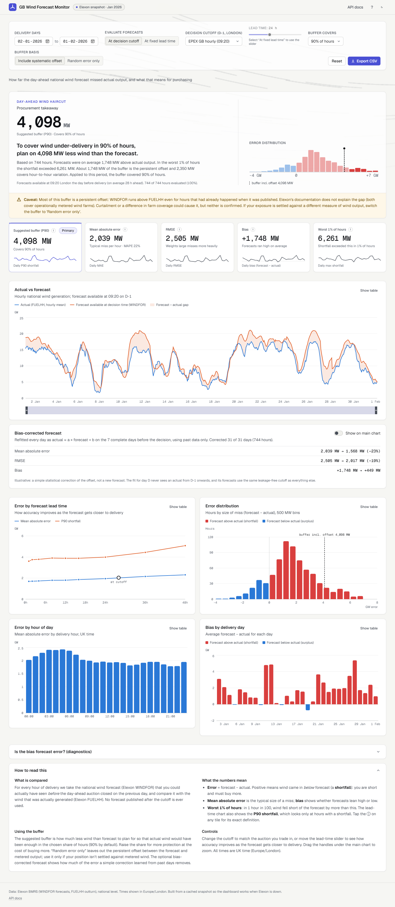
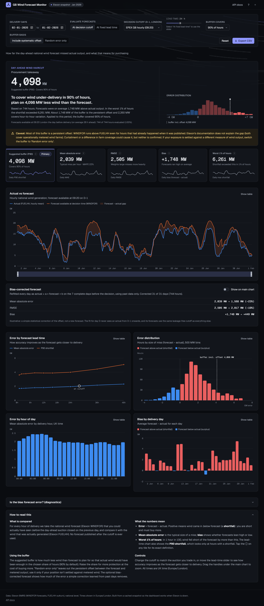
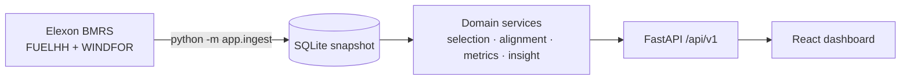

# GB Wind Forecast Monitor

How accurate is the national wind forecast that a GB energy trader can actually see **before** the
day-ahead auction closes, and how much wind should they *not* count on? This app back-tests the Elexon
WINDFOR forecast against FUELHH outturn for decisions made in January 2026. It turns the error into
a buffer recommendation for purchasing.

**Live app:** _not deployed yet. Run `vercel --prod` (see [Deploy](#deploy)) and paste the URL here._



<details><summary>Dark mode</summary>


</details>

## Key findings (January 2026, D-1 09:20 cutoff)

| | |
|---|---|
| Mean absolute error | **2,039 MW** (RMSE 2,505 MW, MAPE 22 %) |
| Bias | **+1,748 MW**: forecasts ran high; wind fell short in **85 %** of hours |
| Worst 1 % of hours | 6,261 MW (P99 of error, same hours as the buffer) |
| Buffer for 90 % cover | **4,098 MW** (= 1,748 MW persistent offset + 2,350 MW random) |
| Out-of-sample | buffer sized on 2–16 Jan covered **90.6 %** of hours on 17 Jan – 1 Feb |
| Rolling bias correction | MAE 2,039 → **1,568 MW (−23 %)**, fitted on past days only (D-8 … D-2) |

About 1.5 GW of the bias is a **systematic offset between WINDFOR and FUELHH**. It persists even in WINDFOR's values for
hours that had already ended, and it grows with wind level (+0.5 GW at 0–5 GW, +2.7 GW above 15 GW).
Curtailment at high wind, or capacity counted in WINDFOR but not in FUELHH, could explain it, but
neither is confirmed and Elexon's docs don't say. The dashboard therefore flags it as a caveat, and the
buffer can be shown with or without the offset. Full write-up: [docs/analysis.md](docs/analysis.md).

## Quick start

The app has two parts: the **API** (FastAPI, port 8000) and the **dashboard** (React). In Docker,
one container serves both on **http://localhost:8000**. In local development, Vite serves the
dashboard on **http://localhost:5173** and forwards `/api` to the API on port 8000.

Prerequisites: [Docker Desktop](https://www.docker.com/products/docker-desktop/) for (a). For (b)–(d),
[uv](https://docs.astral.sh/uv/getting-started/installation/) (it installs Python 3.12 itself) and
[Node 22+](https://nodejs.org/). The repo ships the January 2026 snapshot (`backend/data/wind.sqlite`),
so nothing needs to be downloaded from Elexon to start.

### Windows (PowerShell)

**(a) Docker only**: dashboard and API in one container.
```powershell
powershell -ExecutionPolicy Bypass -File .\dev.ps1 -Docker   # builds, starts, opens http://localhost:8000
# or by hand:
docker compose up --build                                    # then open http://localhost:8000
docker compose down                                          # stop it (frees port 8000)
```

**(b) Local development with `dev.ps1`**: API with auto-reload plus Vite with hot reload.
```powershell
powershell -ExecutionPolicy Bypass -File .\dev.ps1           # then open http://localhost:5173
```
It syncs dependencies, opens the API in a second window, waits up to 60 s for
`/api/v1/health`, and only then starts Vite. It stops with a clear message if port 8000 is taken.

**(c) The same thing in two terminals by hand**
```powershell
# terminal 1: API on http://127.0.0.1:8000
cd backend; uv sync --frozen; uv run uvicorn app.main:app --reload --host 127.0.0.1 --port 8000
# terminal 2: dashboard on http://localhost:5173
cd frontend; npm ci; npm run dev
```

**(d) Re-ingest data from Elexon** (10–60 s; no API key needed)
```powershell
cd backend; uv run python -m app.ingest --from 2025-12-25 --to 2026-02-01   # local file backend\data\wind.sqlite
docker compose run --rm ingest --from 2025-12-25 --to 2026-02-01           # the Docker volume instead
```
Restart the API afterwards, because it loads the snapshot once at start-up. The eight days before
2 January feed the rolling bias correction.

> **Port 8000: Docker *or* local dev, not both.** `docker compose up` publishes port 8000, so a
> local `uvicorn` can't bind it. Your backend code edits then aren't picked up, and the dashboard at
> :5173 talks to the container instead. `dev.ps1` detects this and stops. Fix: run
> `docker compose down` and then start local dev, or keep Docker and use http://localhost:8000. Check
> what holds the port with `docker ps` or
> `Get-NetTCPConnection -LocalPort 8000 -State Listen | Select OwningProcess`.

### macOS / Linux (make)
```bash
make install        # uv sync + npm ci
make dev            # API on :8000 (reload) + Vite on :5173 (proxies /api)
make ingest FROM=2025-12-25 TO=2026-02-01
make test           # pytest + vitest
make lint           # ruff, mypy --strict, eslint, prettier, tsc
make smoke BASE=http://localhost:5173   # hit every endpoint of a running app
docker compose up --build               # Docker, as in (a)
uvx pre-commit install                  # run the checks on every commit
```
Each Makefile target is a one-liner you can also run by hand. CI runs `make install` and
`make dev` on a fresh checkout and smoke-tests every endpoint through the Vite proxy.

Configuration is via `APP_*` environment variables; see [.env.example](.env.example). Nothing is secret.
The optional `APP_REFRESH_TOKEN` enables `POST /api/v1/admin/refresh` on writable hosts.

## Troubleshooting

| Symptom | Cause and fix |
|---|---|
| Dashboard says **"Can't reach the API. Is the backend running on :8000?"** (older builds: "Request failed (500)"). Vite logs `http proxy error ... ECONNREFUSED 127.0.0.1:8000` | Nothing is listening on port 8000, so the Vite proxy answers 500. Start the API: (b) or (c) above, or Docker (a) and open :8000 instead. The dashboard retries by itself, so it recovers once the API is up. A rebuild of the Docker image also leaves the port empty for a while. |
| `dev.ps1`: "Docker app is running on :8000" | The compose container holds the port. `docker compose down`, or use http://localhost:8000. |
| `dev.ps1`: "Port 8000 is in use by …", or uvicorn: `[Errno 10048] ... only one usage of each socket address` | Another process holds the port, often an old uvicorn window. Close it, or find it with `Get-NetTCPConnection -LocalPort 8000 -State Listen` and `Stop-Process -Id <PID>`. |
| `dev.ps1`: "The API did not become healthy within 60 s" | Read the error in the API window. Usually it is a missing snapshot (next row) or a dependency problem; run `cd backend; uv sync --frozen`. |
| API returns 503 "database not found" or "no data ingested" | `backend/data/wind.sqlite` is missing or empty, for example after deleting it. Re-ingest with (d), or restore it with `git checkout -- backend/data/wind.sqlite`. |
| `ZoneInfoNotFoundError: 'No time zone found with key Europe/London'` | Windows has no system time-zone database, so Python needs the `tzdata` package. It is a declared dependency; run `cd backend; uv sync --frozen` and start the API with `uv run …`, not a global Python. |
| `dev.ps1 cannot be loaded because running scripts is disabled` | Run it as `powershell -ExecutionPolicy Bypass -File .\dev.ps1`. That changes no system setting. |
| `uv` not found right after installing it | Open a new terminal, or add `%USERPROFILE%\.local\bin` to `PATH`. |

## API

OpenAPI: `/api/v1/openapi.json`, interactive docs at `/api/v1/docs`. Common query parameters:
`from`, `to` (delivery days), `mode=cutoff|horizon`, `cutoff_time=HH:MM` (default 09:20),
`horizon_h` (0–72).

| Endpoint | Purpose |
|---|---|
| `GET /api/v1/health` | status + snapshot extent + last ingest |
| `GET /api/v1/meta` | data range, cutoff presets, defaults |
| `GET /api/v1/forecast-vs-actual` | hourly rows (actual, selected forecast, bias-corrected forecast, publish time, lead time); `format=csv` |
| `GET /api/v1/metrics` | MAE, RMSE, bias, MAPE, percentiles, shortfall/surplus split, buffer insight (`buffer_basis=total\|random`), worst 1 %, coverage |
| `GET /api/v1/metrics/correction` | raw vs rolling bias-corrected accuracy (cutoff mode only), latest fit |
| `GET /api/v1/metrics/by-horizon` | metrics per lead time (`horizons=1,4,12,24`) + the cutoff reference point |
| `GET /api/v1/metrics/by-hour` / `by-day` | breakdowns by London hour / delivery day |
| `GET /api/v1/error-distribution` | histogram (`bin_mw`) + quantiles |
| `GET /api/v1/diagnostics/bias` | tests for whether the bias is forecast error or an offset, incl. by-level views |
| `POST /api/v1/admin/refresh` | re-ingest (token-protected; disabled on read-only deploys) |

Errors are [RFC 9457](https://www.rfc-editor.org/rfc/rfc9457) `application/problem+json` (400, 404, 422, 502, 503).

## Architecture


Details: [docs/architecture.md](docs/architecture.md). Decisions: [docs/adr/](docs/adr).

## Repository layout

| Path | What it is |
|---|---|
| `backend/app/core/` | `config.py` settings, `logging.py`, `timeutils.py` (London days, DST-safe cutoffs) |
| `backend/app/models/` | `records.py` Elexon wire + domain records; `api.py` response schemas |
| `backend/app/clients/elexon.py` | async httpx client: chunking, retries/backoff/jitter, timeouts, validation |
| `backend/app/repositories/sqlite.py` | schema, idempotent upserts (revisions win), read-only mode |
| `backend/app/services/selection.py` | **the leakage rule**: latest forecast at cutoff / at horizon |
| `backend/app/services/alignment.py` | half-hourly actuals → hourly grid |
| `backend/app/services/metrics.py` | MAE, RMSE, bias, MAPE, percentiles, directional split, histogram |
| `backend/app/services/insight.py` | buffer recommendation + plain-language takeaway + caveat |
| `backend/app/services/diagnostics.py` | bias investigation (hindcast rows; by forecast and actual level) |
| `backend/app/services/correction.py` | rolling linear bias correction on complete past days (no look-ahead) |
| `backend/app/services/analysis.py` | orchestration, coverage, in-memory cache |
| `backend/app/services/ingestion.py`, `quality.py` | fetch → dedupe → quality report → store |
| `backend/app/api/` | routers (`v1/analysis.py`, `v1/system.py`), dependencies, error handlers |
| `backend/app/ingest.py` | ingestion CLI |
| `backend/app/main.py` | app factory (also serves the built frontend when present) |
| `backend/data/wind.sqlite` | bundled January 2026 snapshot (4.3 MB) |
| `backend/scripts/analysis_report.py` | prints every number in `docs/analysis.md` |
| `backend/tests/` | unit (selection, metrics, client, repo, ingestion, service) + API tests |
| `frontend/src/api/` | typed client, response types, TanStack Query hooks |
| `frontend/src/components/` | KPI tiles with definition tooltips, insight, controls, charts, diagnostics, correction panel, chart card (table view, states) |
| `frontend/src/lib/` | formatting (Europe/London), ticks, theme, defaults |
| `dev.ps1`, `Makefile` | Windows launcher (local dev or `-Docker`) and make targets for macOS/Linux |
| `scripts/smoke.sh` | hits every endpoint of a running app (CI, Docker, Vercel) |
| `api/index.py`, `vercel.json`, `requirements.txt` | Vercel function entrypoint and config |
| `Dockerfile`, `docker-compose.yml`, `heroku.yml` | container build (multi-stage, non-root, healthcheck) |
| `.github/workflows/ci.yml` | lint, type-check, test, build and smoke-test the image |
| `docs/` | data notes, architecture, ADRs, analysis, video script |

## Methodology

1. **Data.** Elexon BMRS Insights API (no key). FUELHH `WIND` (half-hourly MW) is the actual; WINDFOR
   (hourly MW, 8 publishes a day, 73 hours each) is the forecast. Endpoints, limits and quirks were
   verified against the live API: [docs/data-notes.md](docs/data-notes.md).
2. **Delivery day and cutoff.** Delivery days are Europe/London calendar days. The decision cutoff is
   **D-1 09:20 London**, the earliest GB day-ahead gate closure (EPEX), so there is no look-ahead for any
   auction. 09:50 (N2EX) and 11:00 (legacy) are presets. [ADR 0002](docs/adr/0002-decision-cutoff.md)
3. **Selection.** Per target hour: the forecast with the greatest `publish_time ≤ cutoff` (and
   `≤ target`). Horizon mode instead uses `publish_time ≤ target − h`.
4. **Alignment.** Actual for hour T = mean of the half-hours at T and T+30 min; incomplete hours are
   dropped and counted. [ADR 0004](docs/adr/0004-forecast-actual-alignment.md)
5. **Metrics.** Error = forecast − actual (positive = shortfall). MAE, RMSE, bias, MAPE (actual ≥ 1 GW
   only), P50/P90/P99 of |error|, and percentiles split into shortfall and surplus.
6. **Buffer.** P-th percentile of the signed error (clipped at 0), split into the persistent offset (mean)
   and the random part. "Random error only" mode uses the de-biased error instead and reports its
   (lower) coverage against FUELHH. Self-checked by applying it back to the data and out of sample.
7. **Bias correction (optional).** For day D, OLS `actual ≈ a·forecast + b` on complete days D-8 … D-2,
   i.e. only actuals known at the D-1 cutoff. Proven by perturbation tests. [ADR 0005](docs/adr/0005-rolling-bias-correction.md)

## Assumptions
- A forecast is usable from its `publishTime`.
- FUELHH `WIND` is the relevant "actual"; national level stands in for portfolio exposure.
- All of January 2026 is representative of the decisions being supported.

## Limitations
- One winter month. The bias may be seasonal or tied to curtailment patterns.
- The cause of the WINDFOR/FUELHH offset is unconfirmed (documentation is silent; see analysis §3).
- WINDFOR stops about 46 h ahead for some hours of the day, so horizons above about 46 h use a subset of hours.
- Buffers are in MW of wind; there is no price or demand data, so the cost of over-cover isn't optimised.
- The Vercel deploy is read-only; refreshing data means re-ingesting and redeploying.

## Future work
- Test the two offset hypotheses: curtailment (BMRS bid-offer acceptances for wind BM units) and
  capacity coverage (unit-level generation). Both are kept out of scope by the brief.
- Level- and hour-conditional bias correction, and evaluating buffers on the corrected forecast.
- Extend to 12+ months and report seasonal / regime-conditional buffers (e.g. by forecast level).
- Conditional buffers: size by forecast level and hour (the error is heteroscedastic).
- Scheduled refresh on a writable host (Cloud Run / Fly.io + object storage) and OpenAPI-generated TS types.
- Price-aware buffer: minimise expected imbalance cost given buy and sell spreads.

## Deploy

Target: **Vercel** ([ADR 0003](docs/adr/0003-deployment-target.md)). You run these commands yourself;
no credentials are stored in the repo. From the repo root (PowerShell or bash):

```bash
npx vercel@65.3.1 login           # interactive, in your browser
npx vercel@65.3.1 link            # "Set up and deploy?" yes; new project; directory ./ ; keep the
                                  # detected settings (vercel.json overrides install/build/output)
npx vercel@65.3.1 --prod          # builds the frontend, bundles api/index.py + backend/{app,data}
bash scripts/smoke.sh https://<project>.vercel.app   # every endpoint + the dashboard must be 200
```
The project must be public: open it in a private window. If Vercel asks you to log in, turn off
*Settings → Deployment Protection → Vercel Authentication* for production.

**Checked locally:** `npx vercel@65.3.1 build --prod` succeeds (it needs `uv` on `PATH`). The Python
function is **116.9 MB unzipped against the 250 MB limit**: pandas 43 MB, numpy 54 MB, the
`wind.sqlite` snapshot 4.3 MB. Tests, docs and the frontend source are excluded, and the static
dashboard is 3 MB. The function opens the snapshot read-only, so `POST /admin/refresh` is disabled there.
After re-ingesting data: `make requirements` (only if dependencies changed), commit, then `vercel --prod`.

Fallback (any container host, e.g. Heroku): `heroku stack:set container -a <app>` then
`git push heroku main`. The image honours `$PORT`.

## AI tools used

Built with **Claude Code (Claude Opus 5.5)**. It verified the Elexon API, implemented the backend,
frontend, tests, CI and docs, and investigated the forecast bias. A human reviewed and
approved the plan at the end of phase 1 and made the key calls (09:20 cutoff, uv toolchain, bias
investigation before presenting results).
