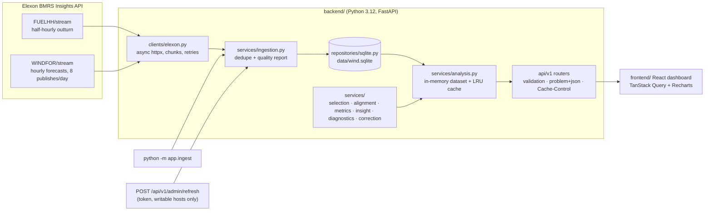
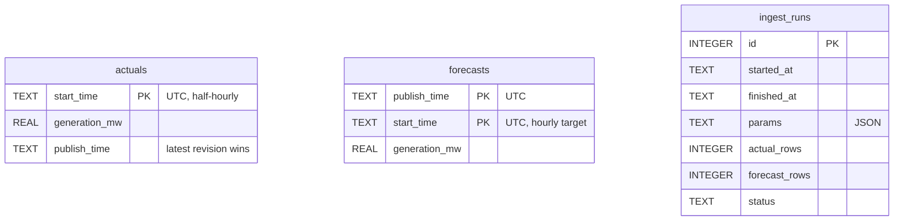

# Architecture

## Overview



The two halves are decoupled on purpose. **Ingestion** is the only code that talks to Elexon. **Serving**
reads only the SQLite snapshot, so the deployed app never depends on Elexon being up.

## Layers (backend/app)

| Layer | Responsibility | Depends on |
|---|---|---|
| `core/` | settings (`pydantic-settings`, `APP_` env), logging, London/UTC time helpers | – |
| `models/` | `records.py`: Elexon wire models + domain records; `api.py`: response schemas | core |
| `clients/` | Elexon HTTP client: chunked requests, retry with backoff and jitter, timeouts, response validation | models |
| `repositories/` | SQLite schema, idempotent upserts, read-only mode, data extent | models |
| `services/` | pure domain logic over pandas frames; no I/O except `analysis.py` (repo) and `ingestion.py` (client + repo) | models, core |
| `api/` | FastAPI routers, dependencies, query validation, error mapping | services, models |

Domain functions (`selection`, `alignment`, `metrics`, `insight`, `diagnostics`, `correction`) are pure
and take frames or arrays. That is why they can be tested with hand-calculated fixtures and a brute-force reference.

## Request flow

1. `GET /api/v1/metrics?from=2026-01-02&to=2026-02-01&cutoff_time=09:20`
2. `api/deps.py:analysis_query` validates the shape (dates, `HH:MM`, horizon 0–72) → 422 problem+json
   on failure. `AnalysisService.validate` checks the range against the snapshot → 400.
3. `AnalysisService.evaluate(q)` returns a cached `Evaluation` or computes one:
   1. slice forecasts whose target falls in the London-day range,
   2. `select_at_cutoff` / `select_at_horizon`: one leakage-free row per target,
   3. inner-join with `hourly_actuals` (hour mean) → `error_mw = forecast − actual`,
   4. record coverage: expected hours, with forecast, with actual, evaluated.
4. `metrics.compute_metrics` and `insight.buffer_recommendation` build the response;
   `Cache-Control: public, max-age=300` is added.

## The leakage rule (services/selection.py)

```
cutoff(D)  = (D − 1 day) at cutoff_time, Europe/London → UTC
eligible   = publish_time ≤ decision_time  AND  publish_time ≤ target_time
selected   = the eligible row with the greatest publish_time, per target
```
`decision_time` is `cutoff(delivery_day(target))` in cutoff mode and `target − h` in horizon mode.
It is returned with every row, so the API response itself proves `publish_time ≤ decision_time`.

## Rolling bias correction (services/correction.py)

For delivery day D: OLS `actual ≈ a·forecast + b` on the cutoff-mode rows of complete days D-8 … D-2,
then applied to D's cutoff forecast. The service evaluates cutoff mode over `history_from … to`
internally (`_cached`, without range validation), applies the correction, and returns only the queried
days. See [ADR 0005](adr/0005-rolling-bias-correction.md).

## Data model



## Frontend (frontend/src)

The brief is [docs/design.md](design.md); the choices are recorded in
[ADR 0006](adr/0006-design-system-and-motion.md).

**Design system.**
- **Tokens:** CSS variables on `:root` / `[data-theme]` in `index.css`:
  - surfaces `--bg`, `--panel`, `--raised`; `--border`;
  - text `--text`, `--text-2`, `--text-muted`; `--accent`;
  - semantic `--actual`, `--forecast`, `--corrected`, `--shortfall`, `--surplus`, `--gap-fill`.
  - Dark is the default and light has its own steps. Series colours pass the colour-blind and
    contrast validator in both themes, and all text passes WCAG AA.
- **Tailwind and charts:** the tokens are exposed to Tailwind v4 through `@theme inline`, together
  with the type scale (`display` … `micro`), radii and motion tokens. Recharts reads the same
  variables through `lib/theme.ts` (`chart.*` are `var()` references), so charts follow the theme
  with no hex values in components.
- **Fonts:** Geist and Geist Mono are self-hosted (`@fontsource-variable`). Tabular numerals are on
  everywhere, and MW values use the mono face.
- **Primitives:** `components/ui/` holds Card, Stat, SegmentedControl, Select, Slider, Button,
  Tooltip/InfoTip, Badge, Skeleton, Collapsible, Switch, Kbd and AnimatedNumber. They are typed,
  share one focus ring and sit on native elements (radios, `<select>`, range, checkbox
  `role="switch"`). Every feature component is built from them.

**Layout.**
- **Header:** sticky.
- **Controls:** a panel at the top, with a compact sticky summary bar once it scrolls away. Below
  1024 px the summary chip opens the same `<Controls>` instance in a bottom drawer; CSS moves it,
  so state and labels never fork.
- **Hero:** the procurement takeaway and buffer, with the buffer line on a plain-SVG mini
  distribution.
- **KPI tiles:** each has a sparkline from `/metrics/by-day`.
- **Charts:** a 2-column chart grid of `ChartCard`s (header, legend, figure label, "Show table",
  shaped skeleton, error/empty states), then collapsible diagnostics and "How to read this".

**State management.**
- **Server state:** TanStack Query, one hook per endpoint, with `placeholderData:
  keepPreviousData`. On a filter change the previous chart stays on screen, dimmed with a progress
  hairline, and fades back when the new data arrives.
- **View state:** lives in the URL (`lib/urlState.ts`, keys `from to mode cutoff h p basis
  corrected`). Only non-default values are written, and each key is validated on read. Discrete
  changes push a history entry; slider drags and date edits replace it. `popstate` restores the
  controls.
- **Theme:** a small external store (`useSyncExternalStore`), so the toggle and the `t` shortcut
  agree.
- **Shortcuts:** `lib/shortcuts.ts`.

**Motion.**
- **Tokens:** `lib/motion.ts`: 150 / 220 / 350 / 400 ms with one ease-out and one ease-in-out curve.
- **Numbers:** AnimatedNumber tweens with a plain rAF loop that writes to its DOM node, so a tween
  never re-renders React.
- **Card entry:** a CSS animation on first load only, so content is never left hidden waiting for
  script.
- **Lines:** draw in on first render only (`useDrawOnce`).
- **Segmented controls:** the indicator slides with `motion/mini`'s `animate` (Web Animations API).
  The selected label is measured only when the value changes or the group resizes, never on
  unrelated renders. (motion's React `layoutId` re-measured on every commit; see ADR 0006.)
- **Wind field:** `WindField.tsx` is a half-resolution canvas at 20 fps with batched strokes, woken
  by a timer rather than every vsync. It starts once the page has loaded and the browser is idle,
  and pauses when hidden or off-screen.
- **Reduced motion:** `usePrefersReducedMotion()` and the CSS `prefers-reduced-motion` rule turn
  all of it off and show final values.

**Performance.**
- **Lazy charts:** the chart components are lazy (`charts/lazy.ts`) and preloaded once the metadata
  arrives. Recharts and React are split into their own chunks, so Recharts never blocks first
  paint.
- **Deferred mounting:** each chart mounts only when its card comes within 400 px of the viewport
  (`lib/useNearViewport.ts`).
- **Fast first paint:** `index.html` carries a static copy of the header and intro, so first paint
  doesn't wait for script.
- **No layout shift:** skeletons have the loaded geometry, and they pulse opacity only (compositor,
  no repaint).
- **Memoisation:** charts, derived rows, the hero, the KPI tiles and the static sections are
  memoised. Hover state stays local to Recharts and the sparkline, and focus rings use sibling
  selectors, not `:has()`.
- **Budget:** `scripts/check-bundle.mjs` enforces it in CI: initial JS ≤ 130 kB gzip (now 81.6 kB,
  previously 175.7 kB in one chunk), total ≤ 260 kB (now 195.7 kB), CSS ≤ 15 kB (8.5 kB).

**Accessibility.**
- **Structure:** a skip link, landmarks, and charts as labelled figures, each with a table view.
- **Interaction:** a visible focus ring, a live region announcing shortcut changes, a modal
  shortcut dialog with focus trap and return, and a drawer that closes on Escape.

## Deployment topologies

| Target | Frontend | API | Data |
|---|---|---|---|
| Local dev | Vite :5173 (proxies `/api`) | uvicorn :8000 `--reload` | `backend/data/wind.sqlite` (rw) |
| Docker / compose | served by FastAPI `StaticFiles` | uvicorn in the same container (non-root) | named volume seeded from the image |
| Vercel (Git-connected, deploys on push to `main`) | CDN (`frontend/dist`) | `api/index.py` serverless function | bundled snapshot, read-only (`immutable=1`) |

## Caching

- **In process:** the full dataset is loaded once. Evaluations are memoised per `AnalysisQuery` (bounded LRU,
  256 entries) and cleared by `reload()` after a refresh.
- **HTTP:** analysis responses send `Cache-Control: public, max-age=300`, so browsers and the Vercel edge can reuse them.
- **Client:** TanStack Query with a 5-minute `staleTime` and `keepPreviousData`, so charts keep their frame while new params load.

## Quality gates

`ruff` (lint + format), `mypy --strict`, `pytest` (services coverage gate ≥ 85 %, currently 99 %),
`eslint` (strict type-checked), `prettier`, `tsc --noEmit`, `vitest`, the bundle-size budget, Playwright e2e
smoke tests against the production build and the real API (desktop and phone), the Docker build plus a smoke test of every endpoint, a fresh-checkout `make install` + `make dev` smoke test, and a
drift check between `uv.lock` and `requirements.txt`. All run in `.github/workflows/ci.yml`; the same
tools run locally via `make lint test` and pre-commit.
