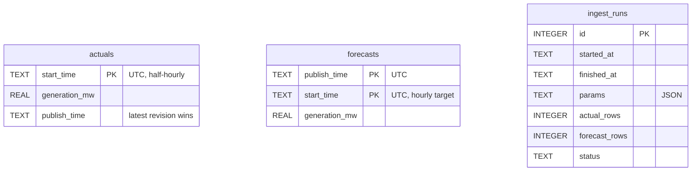

# Architecture

## Overview


The two halves are decoupled on purpose. **Ingestion** is the only code that talks to Elexon. **Serving**
reads only the SQLite snapshot, so the deployed app never depends on Elexon being up.

## Layers (backend/app)

| Layer | Responsibility | Depends on |
|---|---|---|
| `core/` | settings (`pydantic-settings`, `APP_` env), logging, London/UTC time helpers | – |
| `models/` | `records.py`: Elexon wire models + domain records; `api.py`: response schemas | core |
| `clients/` | Elexon HTTP client: chunked requests, retry with backoff and jitter, timeouts, response validation | models |
| `repositories/` | SQLite schema, idempotent upserts, read-only mode, data extent | models |
| `services/` | pure domain logic over pandas frames; no I/O except `analysis.py` (repo) and `ingestion.py` (client + repo) | models, core |
| `api/` | FastAPI routers, dependencies, query validation, error mapping | services, models |

Domain functions (`selection`, `alignment`, `metrics`, `insight`, `diagnostics`) are pure and take frames
or arrays. That is why they can be tested with hand-calculated fixtures and a brute-force reference.

## Request flow

1. `GET /api/v1/metrics?from=2026-01-02&to=2026-02-01&cutoff_time=09:20`
2. `api/deps.py:analysis_query` validates the shape (dates, `HH:MM`, horizon 0–72) → 422 problem+json
   on failure. `AnalysisService.validate` checks the range against the snapshot → 400.
3. `AnalysisService.evaluate(q)` returns a cached `Evaluation` or computes one:
   1. slice forecasts whose target falls in the London-day range,
   2. `select_at_cutoff` / `select_at_horizon`: one leakage-free row per target,
   3. inner-join with `hourly_actuals` (hour mean) → `error_mw = forecast − actual`,
   4. record coverage: expected hours, with forecast, with actual, evaluated.
4. `metrics.compute_metrics` and `insight.buffer_recommendation` build the response;
   `Cache-Control: public, max-age=300` is added.

## The leakage rule (services/selection.py)

```
cutoff(D)  = (D − 1 day) at cutoff_time, Europe/London → UTC
eligible   = publish_time ≤ decision_time  AND  publish_time ≤ target_time
selected   = the eligible row with the greatest publish_time, per target
```
`decision_time` is `cutoff(delivery_day(target))` in cutoff mode and `target − h` in horizon mode.
It is returned with every row, so the API response itself proves `publish_time ≤ decision_time`.

## Data model



## Deployment topologies

| Target | Frontend | API | Data |
|---|---|---|---|
| Local dev | Vite :5173 (proxies `/api`) | uvicorn :8000 `--reload` | `backend/data/wind.sqlite` (rw) |
| Docker / compose | served by FastAPI `StaticFiles` | uvicorn in the same container (non-root) | named volume seeded from the image |
| Vercel | CDN (`frontend/dist`) | `api/index.py` serverless function | bundled snapshot, read-only (`immutable=1`) |

## Caching

- **In process:** the full dataset is loaded once. Evaluations are memoised per `AnalysisQuery` (bounded LRU,
  256 entries) and cleared by `reload()` after a refresh.
- **HTTP:** analysis responses send `Cache-Control: public, max-age=300`, so browsers and the Vercel edge can reuse them.
- **Client:** TanStack Query with a 5-minute `staleTime` and `keepPreviousData`, so charts keep their frame while new params load.

## Quality gates

`ruff` (lint + format), `mypy --strict`, `pytest` (services coverage gate ≥ 85 %, currently 99 %),
`eslint` (strict type-checked), `prettier`, `tsc --noEmit`, `vitest`, the Docker build plus a smoke test, and a
drift check between `uv.lock` and `requirements.txt`. All run in `.github/workflows/ci.yml`; the same
tools run locally via `make lint test` and pre-commit.
